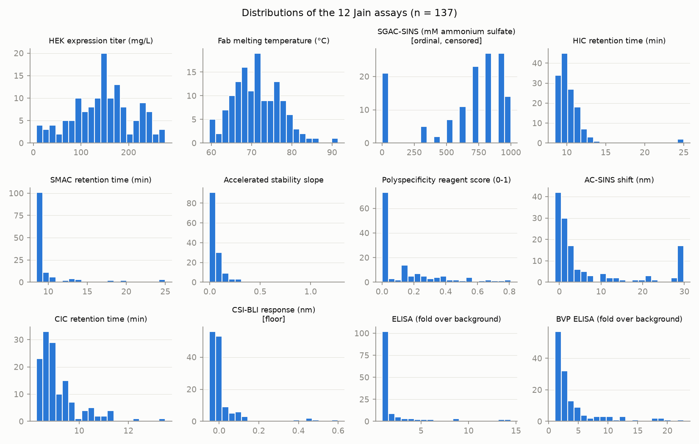
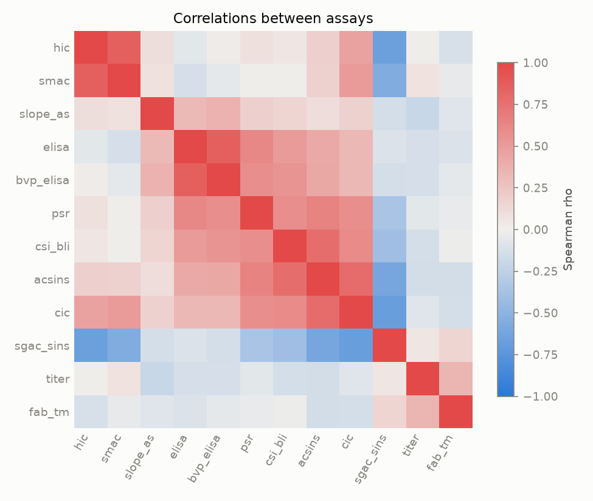
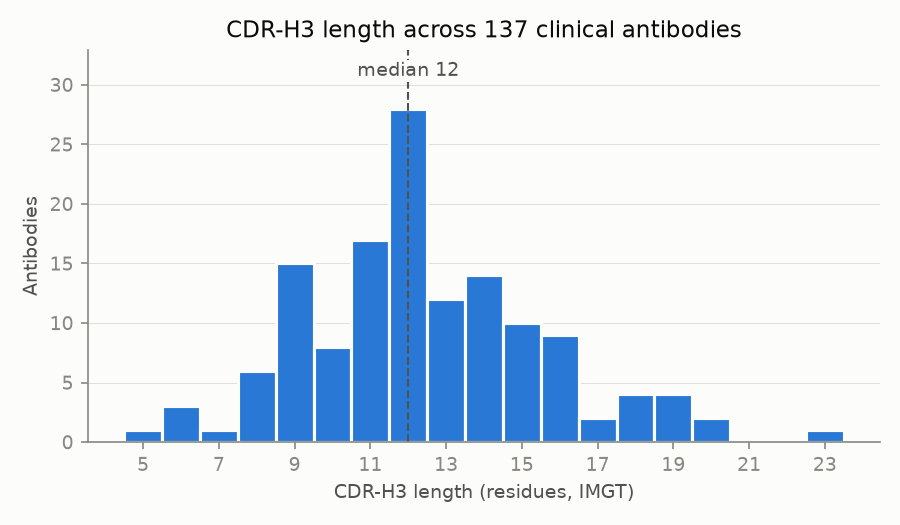
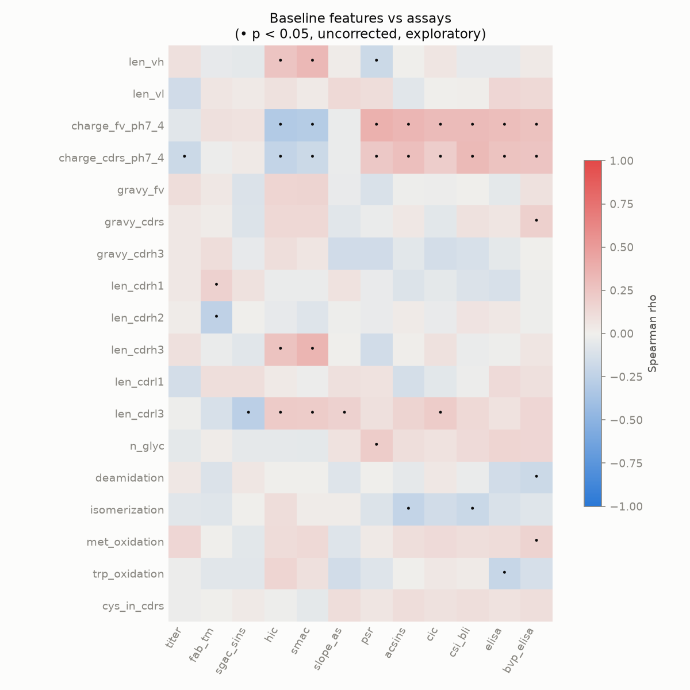
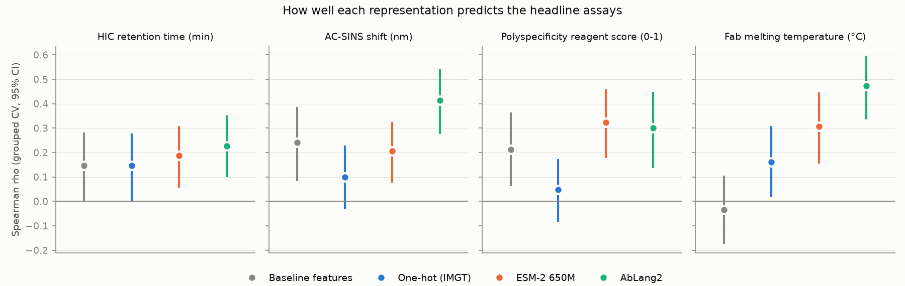
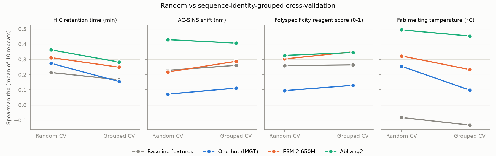
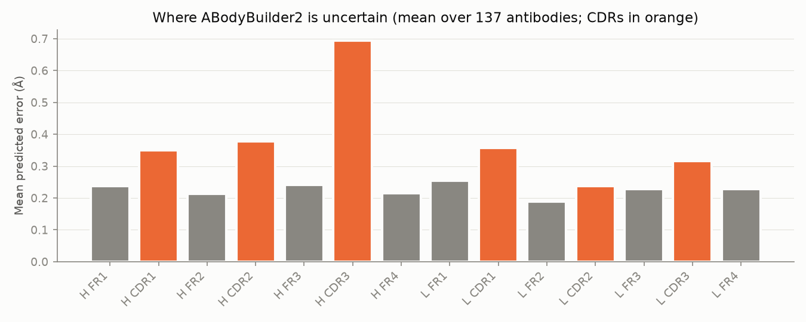
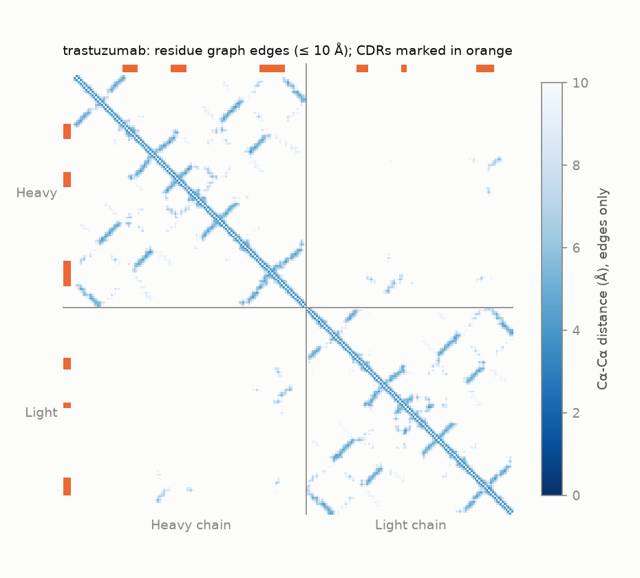
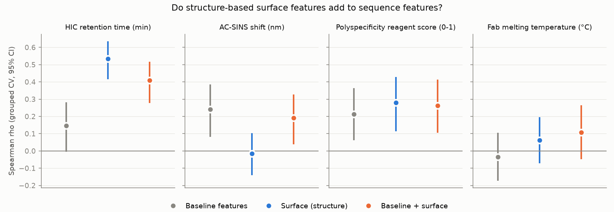

# ABLE

**Antibody Behavior Learning & Evaluation.** Is this antibody able to become a drug? Predicting how
a therapeutic antibody will behave in manufacturing and in the body from its variable-domain
sequences.

Predicting antibody developability (expression, stability, hydrophobicity, self-interaction and
polyreactivity) from sequence and predicted structure, on 137 clinical-stage therapeutic
antibodies. The aim is a careful comparison of simple sequence features, protein language model
embeddings and graph neural networks on structure, evaluated with splits that keep similar
antibodies out of training and test at the same time.

## Why I built this

My research has been in applying machine learning to biological data from the brain: graph
neural networks on functional and structural connectomes, intracranial neural signals, and
lesion-style analyses of attention heads in vision-language models. I had not worked with protein
data, and I built this project to learn it from the ground up and to test whether the habits I rely
on carry over to a new kind of molecule: a public dataset with documented provenance, a simple
baseline that any complex model has to beat, and an evaluation that does not allow near-identical
samples to sit on both sides of a train/test split.

Antibody developability is a good place to do that. The datasets are small because every
measurement requires producing and testing a real molecule, several of the assays are noisy or
censored, and whether a learned representation adds anything beyond charge and loop length is
still an open question. Those are the same conditions I have worked under with clinical cohorts of
a few hundred people, where the honest answer is often that the simple model is hard to beat.

## Data

Jain et al. (2017) measured 137 antibodies that reached clinical trials or approval on 12
biophysical assays. Each antibody comes with its heavy-chain (VH) and light-chain (VL)
variable-region sequence. The pipeline downloads a checksummed copy; source, license, contents
and assay caveats are in [PROVENANCE.md](PROVENANCE.md).

## Method so far

1. **Load** ([able/data.py](able/data.py)): download, verify SHA-256, rename the 12 assays to
   short names, and record for each assay whether higher values are better and whether it is a
   clean continuous readout. SGAC-SINS (ordinal, censored at both ends) and CSI-BLI (most values
   at a floor near zero) are flagged.
2. **Number** ([able/numbering.py](able/numbering.py)): number every VH and VL with ANARCI in
   the IMGT scheme, which places all antibodies on one coordinate system, then cut each chain into
   four framework regions and three complementarity-determining regions (CDRs, the loops that
   bind the target). IMGT boundaries: CDR1 27-38, CDR2 56-65, CDR3 105-117.
3. **Baseline features** ([able/features.py](able/features.py)): chain lengths, net charge at
   pH 7.4 (whole variable region and CDRs only), Kyte-Doolittle hydrophobicity (variable region,
   CDRs, CDR-H3), the six CDR lengths, and counts of chemical liability motifs inside the CDRs
   (N-glycosylation, deamidation, isomerization, methionine and tryptophan oxidation, cysteine).
   These are the descriptors the learned representations in later stages have to beat.

All 137 antibodies number cleanly, with both chains assigned to the expected chain type.

## First look at the data

**The assays.** Most developability readouts are strongly skewed: the majority of clinical
antibodies behave well, and a tail behaves badly. That tail is what a model needs to catch.



**How the assays relate.** The assays fall into groups that measure related properties. HIC and
SMAC, both hydrophobicity measures, correlate strongly (Spearman rho = 0.86), as Jain et al.
reported. The polyreactivity and self-interaction assays (ELISA, BVP ELISA, PSR, CSI-BLI, AC-SINS,
CIC) form a second block. Expression titer and Fab melting temperature stand mostly apart.



**CDR-H3 length.** The third heavy-chain CDR is the most variable part of an antibody. Here it
ranges from 5 to 23 residues (IMGT), with a median of 12.



**Simple features already carry signal.** Net positive charge of the variable region goes with
polyreactivity and self-interaction (PSR rho = 0.37, AC-SINS rho = 0.34, ELISA rho = 0.30) and
with shorter hydrophobic retention (HIC rho = -0.31). Longer CDR-H3 loops go with longer
hydrophobic retention (SMAC rho = 0.35, HIC rho = 0.27). These correlations are exploratory and
not corrected for the 216 feature-assay pairs tested; the full table is in
[`outputs/t_features_vs_assays.csv`](outputs/t_features_vs_assays.csv). CDR-L2 is three residues
long in every antibody here, so it is left out.



## Stage 2: protein language models

**Question.** Do learned representations of the sequence predict developability better than the
simple features from stage 1, once the evaluation stops close relatives from sitting in both
training and test?

**Four representations of each antibody** ([able/encodings.py](able/encodings.py),
[able/embeddings.py](able/embeddings.py)):

| Representation | What it is | Dimensions |
|---|---|---|
| Baseline features | Stage 1: charge, hydrophobicity, CDR lengths, liability counts | 19 |
| One-hot (IMGT) | Each residue at each IMGT address, aligned across antibodies, gaps encoded | 5,292 |
| ESM-2 650M | General protein language model; VH and VL embedded separately, mean-pooled, joined | 2,560 |
| AbLang2 | Antibody language model trained on paired heavy and light chains | 480 |

ESM-2 embeddings were computed on an Apple GPU (MPS) and cached; recomputing on a CPU can change
them in the last decimal places.

**Model and evaluation** ([able/evaluate.py](able/evaluate.py)):
- Ridge regression on standardized features. The scaler and the regularization strength are both
  fit inside each training fold, so the cross-validation is nested.
- 5-fold cross-validation repeated 10 times. The score is the mean over repeats of the Spearman
  rho between out-of-fold predictions and measurements.
- 95% confidence intervals bootstrap antibodies and recompute that same mean rho. The predictions
  stay fixed during resampling, so the intervals capture sampling noise in the evaluation set,
  not the full cost of refitting on new data.
- Permutation p-values (200 label shuffles) for the headline assays.
- Each learned representation is compared with the baseline features by paired bootstrap on the
  same mean rho, Holm-corrected across the 12 comparisons. With 2,000 resamples, a raw p-value
  cannot be resolved below 0.0005, so it is reported as at least that.
- The headline assays were fixed before any results, one per property family: HIC
  (hydrophobicity), AC-SINS (self-interaction), PSR (polyreactivity) and Fab Tm (stability).

**Splits that respect sequence similarity.** Pairwise sequence identity is computed over
IMGT-aligned positions of both chains. Antibodies are grouped by single-linkage clustering at an
identity of 0.8, which guarantees that no two antibodies in different groups are 80% identical or
more. The maximum identity across groups is 0.799. Grouped cross-validation keeps each group on
one side of every split. This gives 61 groups. The largest holds 39 antibodies, because single
linkage chains relatives of relatives together, and 48 antibodies form groups of their own.

The identity analysis was itself informative. The CDRs of these clinical antibodies are nearly
all distinct (median pairwise CDR identity 0.31), while their frameworks are shared (median
full-Fv identity 0.60). Close relatives here are mostly antibodies built on similar germline
frameworks, not copies of the same binder.



**Results (grouped CV).**
- **Stability: a clear gain from language models.** The simple features do not predict Fab
  melting temperature (rho = -0.03, 95% CI -0.17 to 0.10). AbLang2 reaches rho = 0.47 (0.34 to
  0.60) and ESM-2 0.31 (0.15 to 0.45). Both improvements over the baseline survive Holm correction
  (AbLang2 +0.51, ESM-2 +0.34, adjusted p = 0.006 for each, the smallest value this test can
  give). Stability depends on how the whole domain packs, which charge and loop length do not
  capture.
- **Hydrophobicity, self-interaction, polyreactivity: no gain that survives correction.**
  - AbLang2 scores rho = 0.41 against 0.24 for the baseline on AC-SINS (difference +0.17, raw
    p = 0.044, adjusted p = 0.40).
  - ESM-2 scores 0.32 against 0.21 on PSR.
  - On HIC all four representations sit between 0.15 and 0.23.

  These properties are largely surface charge and hydrophobicity, which the simple features
  already describe.
- **One-hot is the weakest learned representation.** Its best headline result is Fab Tm
  (rho = 0.16). With about 110 training antibodies and 5,292 sparse columns, ridge has little to
  learn from.

Fourteen of the 16 headline models beat shuffled labels (permutation p of 0.05 or less). The two
exceptions are the baseline features on Fab Tm (p = 0.28) and one-hot on PSR (p = 0.065). One-hot
on HIC sits at the boundary (p = 0.05, CI -0.002 to 0.28). With 200 shuffles the smallest possible
p is 0.005. The full 12-assay table is in
[`outputs/t_stage2_results.csv`](outputs/t_stage2_results.csv) and is exploratory. It includes the
flagged SGAC-SINS and CSI-BLI rows. The paired comparisons are in
[`outputs/t_stage2_comparisons.csv`](outputs/t_stage2_comparisons.csv).



**Random vs grouped cross-validation.** The assay most inflated by random splits is HIC. Under
grouping, every representation drops:

| Representation | Random | Grouped |
|---|---|---|
| ESM-2 | 0.31 | 0.19 |
| AbLang2 | 0.36 | 0.23 |
| One-hot | 0.28 | 0.15 |
| Baseline | 0.21 | 0.15 |

Hydrophobicity seems to run partly in framework families, so a random split lets a model score
by recognizing the family. One-hot on Fab Tm also drops, from 0.26 to 0.16. Most other headline
scores change by a few hundredths, comparable to the spread between repeats. The stability result
holds up under grouping (AbLang2 0.49 to 0.47, ESM-2 0.32 to 0.31).

**Limitations.**
- 137 antibodies, one lab, and one linear model.
- The confidence intervals are wide, and a difference of 0.1 in rho falls inside them for most
  assays.
- The largest identity group holds 39 antibodies, so the grouped folds are unequal in size.
- A nonlinear model, or fine-tuning the language models, could change the picture. Doing either
  safely would need far more than 137 antibodies.

## Stage 3: structure

**Question.** Does the 3D shape of an antibody tell us anything about developability that its
sequence does not?

**Predicted structures** ([able/structure.py](able/structure.py)). There are no experimental
structures for most of these antibodies, so each Fv is predicted with ABodyBuilder2 (ImmuneBuilder;
Abanades et al., 2023). It is an antibody-specific deep learning model built on the AlphaFold2
structure module. It runs an ensemble of four models, and the spread between them is its
per-residue error estimate. The model closest to the ensemble average is kept, and OpenMM refines
it to remove steric clashes. All 137
antibodies were predicted with no failures, in 11 minutes on a laptop. Each structure is checked
against its input sequence residue by residue, and its IMGT numbering matches stage 1 exactly.



**Where the predictions are uncertain.** CDR-H3 has the highest mean predicted error of the 14
regions: 0.69 Å, against a mean of 0.28 Å over all residues. Per antibody, the CDR-H3 mean error
ranges up to 3.27 Å. That is the expected pattern, because CDR-H3 is the most variable loop and the
hardest to model. These are predicted structures, and their least reliable part is the part that
matters most for binding.

**Residue graphs** ([able/graphs.py](able/graphs.py)). Each structure becomes a graph with one node
per residue (at its Cα atom), and an edge wherever two Cα atoms are within 10 Å.
- Node features: amino acid, chain, framework or CDR, and predicted error.
- Edge feature: distance.

Graphs have 220 to 238 nodes, about 2,070 undirected edges and a mean degree of 18.2. Distances do
not change when a structure is rotated or moved, so the graph does not depend on how the molecule
happens to sit in the file. These graphs are the input for the graph neural network in stage 4.



**Surface features** ([able/surface.py](able/surface.py)). Solvent-accessible surface area
(Shrake-Rupley) is computed per residue, and each residue is called exposed when its area is at
least 25% of its theoretical maximum (Tien et al., 2013). Nine features summarize it:
- total, hydrophobic, positive (K, R) and negative (D, E) surface area
- the hydrophobic fraction of the surface
- hydrophobic and positive surface area within the CDRs
- the exposed net charge (count of exposed K and R minus exposed D and E)
- the number of exposed hydrophobic residues in CDR-H3

The area features sum over all residues; buried residues contribute almost nothing. The 25%
threshold is used only for the two count features.

They are evaluated with the stage 2 engine and the same identity groups. Each comparison is
against the stage 1 sequence features, Holm-corrected across 8 comparisons.



**Results (grouped CV).**
- **HIC: surface features predict it far better than anything so far.** All nine surface features
  together reach rho = 0.54 (95% CI 0.42 to 0.64), against 0.15 for the stage 1 sequence features
  (difference +0.39, adjusted p = 0.004) and 0.23 for AbLang2, the best stage 2 representation on
  HIC (difference +0.31, adjusted p = 0.002 in a separate paired test). SMAC, the other
  hydrophobicity-related assay, follows (rho = 0.39).
- **The signal is in charge as much as in hydrophobic surface.** An ablation on HIC
  ([`outputs/t_stage3_ablation.csv`](outputs/t_stage3_ablation.csv)) shows this:

  | Features | HIC rho (grouped CV) |
  |---|---|
  | Hydrophobic surface features alone | 0.18 |
  | Charge surface features alone | 0.39 |
  | All nine surface features | 0.54 |
  | Sequence-only counts of K+R and D+E | 0.31 |
  | Stage 1 features plus those counts | 0.26 |

  The strongest single feature is positive surface area, which goes with shorter HIC retention
  (rho = -0.43). The stage 1 features held net charge but not the number of charged residues.
  Simply counting them gets HIC to 0.31 without any structure. The structure-based charge features
  are not significantly better than those counts (+0.08, p = 0.09). The full surface set is
  (+0.27 over stage 1 plus counts, adjusted p = 0.002). The gain from structure comes from
  combining where charged and hydrophobic residues sit on the surface, not from hydrophobic
  exposure alone.
- **Self-interaction: structure alone is worse.** On AC-SINS, surface features score rho = -0.02,
  significantly below the sequence features (difference -0.26, adjusted p = 0.012). Combining the
  two recovers most of the sequence-feature performance (0.19).
- **Combining helps stability a little.** Sequence plus surface features improve Fab Tm over
  sequence features alone (+0.14, adjusted p = 0.012). At rho = 0.11, this is still far below the
  language models in stage 2 (AbLang2, 0.47).
- **Combining is not always better.** On HIC, sequence plus surface (0.41) scores below surface
  alone (0.54). With about 110 training antibodies, extra weakly related features likely cost ridge
  more than they add.

Random and grouped cross-validation give similar results for the surface features (HIC 0.55
random, 0.54 grouped). With only nine features, ridge has little room to memorize sequence
families. The full tables are in
[`outputs/t_stage3_results.csv`](outputs/t_stage3_results.csv),
[`outputs/t_stage3_comparisons.csv`](outputs/t_stage3_comparisons.csv) and
[`outputs/t_stage3_ablation_tests.csv`](outputs/t_stage3_ablation_tests.csv).

**Limitations.**
- The structures are predictions, least reliable in CDR-H3.
- They come from a single prediction method, and only for the Fv, not the full IgG.
- SASA on a static model ignores flexibility.
- The exposure threshold (25%) and the hydrophobic residue set are conventional choices that
  were not tuned.

## Status

Stages 1 to 3 of 4 are done. Planned next:

1. ~~Sequences: numbering, CDRs, baseline features, exploration.~~
2. ~~Protein language models (ESM-2, AbLang2) with ridge regression, random vs grouped
   cross-validation.~~
3. ~~Predicted 3D structures, residue graphs and surface features.~~
4. Graph neural network on structure, sequence and structure combined, full evaluation.

A later part adds an active learning simulation on mutational scanning data.

## How to run

```bash
brew install hmmer            # or: sudo apt-get install hmmer
conda create -n able python=3.12
conda activate able
pip install -r requirements.txt
pip install -e .

# Only for predicting structures (scripts/45_predict_structures.py):
conda install -c conda-forge pytorch openmm pdbfixer   # one OpenMP runtime for all three
pip install ImmuneBuilder

pytest                        # unit tests, no network needed
bash run_all.sh               # data, numbering, features, embeddings, evaluation, structures
```
